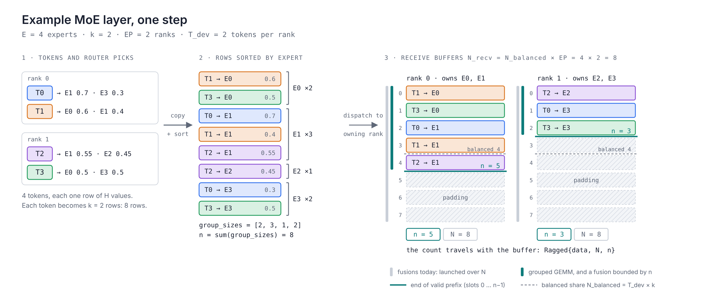

# Dynamic buffer extents in MoE


## Introduction
The AMD JAX team wishes to optimize the MoE layer for various JAX workloads. During our investigation we noticed that a considerable amount of throw-away GPU work is produced by the XLA compiler. Similar layers on other stacks do not face the same constraint. PyTorch is not bound by whole-model compilation and can make kernel-selection and shape-dependent decisions at runtime, while TPU fusions can bound a loop at runtime. We believe a deliberately narrow change would let XLA emit fusions that handle such cases automatically: let a fusion bound its loop by the device-resident row count, and let that count travel with the buffer. The optimization is independent of the underlying GPU.

## An example MoE layer

To motivate this discussion and simplify terminology, we present an example MoE layer and concretize it with sample parameters.

Let's assume **E = 4** experts, **k = 2** experts per token, **EP = 2** ranks (rank 0 owns E0 and E1, rank 1 owns E2 and E3), **T_dev = 2** tokens per rank, hidden width H. During one step:

1. **Route.** The router picks k = 2 experts per token with a weight each: T0 → E1 (0.7), E3 (0.3); T1 → E0, E1; T2 → E1, E2; T3 → E0, E3.
2. **Copy.** Each chosen expert runs its own MLP on the token, so each token becomes k rows, one per (token, expert) pair. 4 tokens × k = 8 rows. A rank's share at perfect balance is the **balanced share**, `N_balanced = T_dev × k = 4`.
3. **Sort.** Rows are grouped by expert. `group_sizes = [2, 3, 1, 2]` counts rows per expert.
4. **Dispatch.** Each row goes to the rank that owns its expert. The receive buffer must admit the legal worst case, every row landing on one rank, so its **capacity** is `N_recv = N_balanced × EP = 8`. (The exact bound depends on the dispatch algorithm. A token can place at most `min(k, E/EP)` of its rows on one rank, so the tight form is `N_recv = N_balanced × min(EP, E/k)`. The two agree whenever `E/k ≥ EP`, which holds in the example and in the case study below, so the note keeps the simpler form.)
5. **Expert GEMMs, gated epilogue, unsort and combine** run on the received rows; the k outputs per token are weighted and summed back to one row.


*Figure 1. The example layer's step. Rank 0 receives 5 rows into a buffer of 8; rank 1 receives 3. The teal line is the end of the valid prefix; the dashed line is the balanced share. The grey bar beside each buffer is what today's fusions launch over, the teal bar is what the grouped GEMM computes.*

Three terms carry the rest of the note:

- **Live count** `n = sum(local group_sizes)`: 5 on rank 0, 3 on rank 1. A number of rows, held on the device, different every step.
- **Valid prefix**: rows are sorted and packed from slot 0, so the live rows are exactly slots `0 … n−1`. One scalar describes them.
- **Extent**: the valid-prefix length attached to a capacity-shaped buffer. Capacity stays static; only the extent is dynamic.

At balance, the padding fraction is `(EP − 1)/EP`: half the buffer in the example, seven eighths at EP = 8. Shrinking the allocation below `N_recv` means dropping routed tokens, which changes training semantics; it is not an optimization a compiler can make.

## Problem Statement

An MoE layer routes tokens at runtime, so the number of valid rows in its receive buffer is a device scalar computed every step. XLA has that number and discards it. XLA does know how many rows of the buffer are live: the count is an operand of the grouped GEMM and the source of the liveness mask. But that knowledge does not reach the layers of the fusion pipeline that decide what a kernel does. Fusion decisions, launch geometry and the generated kernel body are all derived from the static capacity shape, so every fused kernel downstream of the dispatch computes on the padded rows as well as the live ones.

The cost is paid three times over. Each consumer fusion loads, computes and stores the full capacity; the grouped GEMM producer zero-fills the tail because its consumers cannot be told to ignore it; and the mask that is meant to limit the damage is itself a capacity-shaped tensor that every consumer re-reads. At balance the padded fraction is `(EP − 1)/EP`, seven eighths at EP = 8, so most of this work is thrown away by construction, not by bad luck in routing. In the GPT-OSS-120B case study below, 28% of the training step is spent in fusions iterating over token rows that do not contribute to the output.

The fix cannot come from the model code. A mask changes values, not launch geometry. Shrinking the buffer drops tokens. Bucketing by `lax.switch` multiplies residual memory under `jax.grad`. Only the compiler can bound the loop by a device-resident count, and the rest of this note argues that it already holds every piece needed to do so.

### Wasted compute despite masking

To estimate the extent of wasted compute, consider the following case. A fusion over rank 0's buffer launches threads for all 8 slots whether n is 5 or 1. XLA sizes the launch grid from the output shape, which is the capacity. The predicate `jnp.arange(8) < n` only decides what the last three threads write: they still load, compute and store. The GPU issues the loads before it evaluates the predicate, so the masked and unmasked kernels run in the same time as shown in the case study later.

### Where the extent gets lost

Three places need n. None can receive it.

**The producer.** The grouped GEMM reads `group_sizes` and computes only slots 0–4. But its output contract is a full `[8, H]` tensor and its consumers cannot be told to ignore slots 5–7, so the kernel library zeroes them. Every step, for each of the layer's three GEMMs, forward and backward.

**The mask.** `jnp.arange(N_recv) < n` describes the prefix exactly. Broadcast to `[N_recv, H]`, it is an elementwise boolean: it can change values, not launch geometry, and it is not a property of the result. It is materialized once per layer, stored, and re-read by every consumer, each of which launches over every slot.

**The custom call.** An FFI buffer carries a pointer, a dtype and static dimensions. There is no field for n on the way in and no way to report "I wrote slots 0–4" on the way out.

**Why not fix it inside the FFI call?** Because the waste is outside it. The grouped GEMM already loops to n; the cost is in the fusions XLA emits *after* it, from an output shape of `[N_recv, H]`. Pulling those into the call means a hand-written VJP per activation, dtype and quantization, it still leaves the producer zeroing a tail XLA believes is defined, and it widens the region XLA cannot fuse across or schedule against. Only the consumer's contract can lift those three costs.

### Relevant XLA Pieces

All references are to openxla/xla at `131bf41a`.

XLA has the representation. `Layout::dynamic_shape_metadata_prefix_bytes_` (`xla/layout.h`) stores runtime dimension sizes beside a bounded array, and `SliceToDynamic` / `PadToStatic` have GPU emitters (`xla/service/gpu/thunk_emitter.cc`).

What it lacks is using the number as a bound. `kGetDimensionSize` and `kSetDimensionSize` are in the elemental fusion emitter's `kUnsupportedOps` (`xla/codegen/emitters/elemental_hlo_to_mlir.cc`). `CalculateLaunchDimensions` takes a static `Shape`. Even the `SliceToDynamic` emitter reads the runtime size only to guard a store inside a launch over capacity. The value acts as a predicate, never as a trip count.

**`dynamic_slice`** has a runtime start, not a runtime length. Choosing among statically compiled sizes with `lax.switch` under `jax.grad` keeps every branch's residuals live.

**`ragged_dot`** does not close the gap. Where it lowers to a grouped GEMM, `group_sizes` is an operand and the result is a plain `[N_recv, H]`: the compiler sees n at the GEMM and drops it at the output. Where it does not lower, it expands to a dense dot. Pallas kernels are custom calls and inherit the FFI limits above.

**Where else this appears.** Nothing above is ROCm-specific: the fusion emitter, `kUnsupportedOps` and `CalculateLaunchDimensions` are shared code, so JAX MoE on NVIDIA produces the same capacity-shaped fusions; the experimental cuDNN ragged-dot fusion pulls the epilogue into the GEMM on CUDA but carries nothing downstream. PyTorch stacks (Megatron, DeepEP, TE) do not see the problem because the host reads the arrived row count after dispatch and allocates exactly n rows; the price is a sync and no whole-program compilation. TPU likely sidesteps it: a TPU fusion is a scalar-core loop rather than a launched grid, so a runtime trip count is natural there, and MaxText's TPU path runs the expert GEMM through Megablox. *[confirm with the TPU side]*

## Proposed Solution in XLA

### Suggested approach

Three changes, in order of increasing reach. Each is useful on its own and each makes the next one cheaper.

1. **Bound the fusion loop by the live count.** Let a loop fusion take n as a kernel argument and iterate over the valid prefix `0 … n−1`, while the launch grid stays static and sized from the capacity. Threads past the extent exit immediately. Nothing on the host depends on a device value, so command buffers and graph capture are unaffected. This is the step with the measured payoff: it removes the loads, compute and stores for the padded rows in every consumer of the buffer.
2. **Let the result type carry the count.** Once a fusion can be bounded, its output should say how many rows it wrote, so the next consumer inherits the extent instead of receiving a fresh mask. XLA's bounded shape `bf16[<=N, H]` is this type; what is missing is keeping it alive past the dynamic padder and into the emitter. With this, the mask tensor disappears from the layer and the extent flows through the whole MoE block by type, not by convention.
3. **Let FFI custom calls opt in.** A handler that declares a bounded buffer receives `{data, N, n}` and reports the n it wrote. Only the grouped GEMM needs to adopt it; its consumers then stop being custom and the producer stops zero-filling a tail its consumers no longer read.

The first alone is enough to start and captures most of the measured waste; having all three would be ideal.

### How n reaches the fusion

The runtime value n enters HLO as an ordinary device scalar: a parameter, or the result of a `reduce` over `group_sizes`. What differs between today and the proposal is what the HLO does with it. Shapes below use the rank 0 buffer from the example, `N = 8`, and the case-study hidden width.

**Today.** n is folded into a predicate. JAX's `jnp.where(jnp.arange(N)[:, None] < n, act, 0)` lowers to the fusion on the left, and the launch grid is computed from the static result shape:

```
fused_epilogue {                               // what XLA emits at 131bf41a
  p0   = bf16[8,2880] parameter(0)             // receive buffer at capacity
  p1   = s32[]        parameter(1)             // n, a device scalar
  iota = s32[8,2880]  iota(), iota_dimension=0
  nb   = s32[8,2880]  broadcast(p1), dimensions={}
  mask = pred[8,2880] compare(iota, nb), direction=LT
  act  = bf16[8,2880] ...                      // clamp, gate, multiply over all 8 rows
  zero = bf16[8,2880] broadcast(bf16[] constant(0)), dimensions={}
  ROOT out = bf16[8,2880] select(mask, act, zero)
}
// grid: 8 × 2880 threads, whether n is 5 or 1
```

n is consumed inside the kernel body, after the loads. The emitter cannot tell that `mask` describes a prefix, and the result `bf16[8,2880]` says nothing about it, so the next fusion rebuilds the same predicate.

**With the extent.** XLA already has an op that attaches a runtime size to a dimension, `set-dimension-size`, and a shape that records it, `bf16[<=8,2880]`. The same computation written against that type has no iota, compare or select:

```
ENTRY step {
  recv = bf16[8,2880]   parameter(0)
  n    = s32[]          parameter(1)
  live = bf16[<=8,2880] set-dimension-size(recv, n), dimensions={0}
  ROOT out = bf16[<=8,2880] fusion(live), kind=kLoop, calls=fused_epilogue
}

fused_epilogue {
  p0 = bf16[<=8,2880] parameter(0)             // the operand type carries n
  ROOT act = bf16[<=8,2880] ...                // clamp, gate, multiply
}
// grid: still 8 × 2880 from the bound; the kernel loops to n × 2880
```

Here n is a kernel argument, not a value in the body, and the result is typed `<=8`, so the next consumer inherits it. This is the HLO shape of steps 1 and 2 above.

**What happens to the second form today.** The GPU pipeline runs `DynamicPadder` (`xla/service/dynamic_padder.h`, added in `gpu_compiler.cc`) well before fusion. It uses `DynamicDimensionInference` to find bounded shapes, rewrites every `<=8` to a static `8`, inserts identity-value padding where a consumer would otherwise read garbage (a select against a mask before a reduce, for instance), and keeps n only at the entry boundary as a `SliceToDynamic` or `PadToStatic` custom call. By the time the fusion emitter runs, the module looks like the first form again. That is why `kGetDimensionSize` and `kSetDimensionSize` sit in the emitter's `kUnsupportedOps`: they never arrive.

**Two ways to carry n across that gap.**

- *Attach it as metadata.* After `DynamicPadder` has made shapes static, record on the fusion instruction that dimension 0 of its operand and result is bounded by a named scalar operand, for example in `OpMetadata` (`xla/xla_data.proto`) or a frontend attribute, and have the fusion emitter pass that operand as a kernel argument and bound its loop by it. Shapes stay static, so nothing else in the pipeline changes. This is the least invasive route to step 1.
- *Keep the bounded shape alive.* Let `DynamicPadder` leave `<=N` on dimensions it can prove are a packed prefix, and teach `CalculateLaunchDimensions` and the elemental emitter to read the runtime size from the layout's `dynamic_shape_metadata_prefix_bytes_`, which `SliceToDynamic` already writes. More work, but the type then travels on its own, which is step 2.

**A runnable pair.** JAX has no public API that emits `set-dimension-size`, so the example is hand-written HLO in the style of `xla/service/dynamic_padder_test.cc`. The branch `moe-dynamic-extent-hlo` of our openxla/xla clone adds `xla/service/dynamic_padder_moe_extent_test.cc` with both forms above on an `f32[8,2]` buffer, `n = 5`, and a test vector whose padding rows would contribute 5000 each if any consumer read them. Four tests: the masked and bounded forms both produce `[5, 5]`; after `DynamicPadder` the bounded form *is* the masked form (reduce operand is `select(iota < n, act, 0)`, every shape static, no `set-dimension-size` left); and with the bounded value as the entry result, n survives only in a `SliceToDynamic` custom call whose operand is a static `[8,2]` multiply. The tests are written to the existing pattern but not yet built or run.

### The extent as a type

```
Ragged {
  data        # existing buffer
  capacity N  # static: allocation, layout, verification bound   (8 in the example)
  extent n    # device scalar; or offsets[0..G] for grouped rows (5 on rank 0)
  invariants  # n <= N; offsets monotone and sum to n; n % A == 0
}
```

This is XLA's bounded `bf16[<=N, H]` plus grouped offsets and declared invariants. The invariants are codegen information a mask cannot express: `n ≤ N` is the safety bound, the offsets relate expert slices to the enclosing value, and `n % A == 0` recovers aligned accesses. Differentiation is simple: writing a prefix of n rows transposes to reading one.

**At the FFI boundary** the convention is opt-in. A handler that declares a plain buffer gets today's contract. One that declares a bounded buffer receives `{data, N, n}` and reports the n it wrote, in the same metadata slot `SliceToDynamic` uses. Only the grouped GEMM needs to adopt it; its consumers then stop being custom. On the JAX side this is a bounded result in `jax.ffi.ffi_call`, something like `<=N` on one dimension of `result_shape_dtypes`, so the type survives tracing.

**The first step** (item 1 of the suggested approach) is a fusion that takes n as a kernel argument and loops to it under a static launch grid:

```
for (i = tid; i < n * H; i += nthreads)   // n read from device memory; grid unchanged
    out[i] = f(in[i]);
```

Threads past the extent exit at once, the host builds nothing from a device value, and command buffers and graph capture are unaffected. The allocation can stay at capacity until results can carry a shorter extent.

Not requested: reshuffling tokens between ranks to manufacture static shapes, or a capacity factor that drops tokens. Communication is already a large share of the step, and trading more collectives for a simpler type starts from the wrong cost model.

## Case study: GPT-OSS-120B on 8 × MI355X

The example layer mentioned earlier but at production scale, with MaxText on JAX/XLA, ring dispatch, dropless.

**Table 1.**

| Symbol                             | Example |             GPT-OSS-120B |
| ---------------------------------- | ------: | -----------------------: |
| E, k, H                            | 4, 2, H |            128, 4, 2,880 |
| EP                                 |       2 |                        8 |
| T_dev (tokens per rank)            |       2 | 16,384 (batch 8 × 2,048) |
| N_balanced = T_dev × k             |       4 |                   65,536 |
| N_recv = N_balanced × EP           |       8 |                  524,288 |
| Padding at balance                 |     50% |                    87.5% |
| One bf16 receive buffer, per layer |       — |                 2.81 GiB |

**Table 2. One kernel.** The gated epilogue (clamp, sigmoid gate, multiply) on an otherwise idle MI355X. The first two rows have identical shapes and differ only in the predicate. *[state the tensor shape]*

| Variant | Traffic (cost model) | Median runtime |
|---|---:|---:|
| Masked, all rows live | 16.876 GiB | 3.331 ms |
| Masked, ¼ of rows live | 16.876 GiB | 3.322 ms |
| Kernel sized to the live extent | 4.219 GiB | 0.909 ms |

Masking 75% of the rows changes runtime by 0.3%, within noise. Shrinking the iteration space gives 3.66×.

**Table 3. One training step**, 2.202 s. Kernel trace joined to the optimized HLO of the same module; every traced fusion matched.

| Fusion time | s / step | % of step |
|---|---:|---:|
| All fusions | 0.729 | 33.1% |
| … that touch the worst-case buffer | 0.613 | 27.8% |
| … of those, already carrying a liveness mask | 0.437 | 19.9% |

A fusion "touches the buffer" if an operand or result has the capacity shape, and "carries a liveness mask" if its body contains the `iota < broadcast(scalar)` predicate.

Fusions are the largest item in the step, ahead of the grouped GEMMs at 27.5%. Seventy-one percent of the buffer-touching fusion time already receives a liveness predicate; it shortened nothing. Two ragged all-to-all modules at the same EP show the same pattern: 80% and 79% of their fusion time is on the buffer.

**Zero-fill.** Transformer Engine's tail zeroing costs 0.208 s per step: seven eighths of each GEMM output at EP = 8.

**A diagnostic, not a fix.** Setting capacity to `N_balanced` (which drops tokens, and produced NaNs in sibling runs) cuts the step by 0.640 s. Buffer-touching fusions account for 0.448 s; zero-fill for 0.201 s (0.208 → 0.007 s). The rest of the module is unchanged.

**`dynamic_slice` buckets.** A two-bucket `lax.switch` under `jax.grad` used 6.25× the masked baseline's peak memory; four and eight buckets ran out of memory.

**`ragged_dot` on this hardware.** At `131bf41a`, `kRaggedDot` lowers to hipBLASLt grouped GEMM for f16 and bf16 on gfx942 but f16 only on gfx950; bf16 on MI355X expands to a dense dot (`RaggedDotRewriter::RaggedToGeneral`). That is why this configuration runs the grouped GEMM as a Transformer Engine custom call today.

**What the first step is worth here.** 3.66× on the epilogue kernel, and 28% of the step is in kernels like it.

## Appendix: the compiler's view of n, step by step

Everything below is taken from the gfx1201 dumps of 2026-10-23 and 2026-10-27 on a capacity-sized `f32[65536,256]` buffer (`2026-10-23-gfx1201-results.md`, `2026-10-27-gfx1201-kernel-ir-and-timing.md`). It is the same program as in "How n reaches the fusion", followed all the way to the instruction that wastes the work.

### The masked form, which JAX emits today

```
ENTRY entry {
  recv = f32[65536,256] parameter(0)          // receive buffer at capacity
  n    = s32[] parameter(1)                   // live row count, a device scalar
  iota = s32[65536,256] iota(), iota_dimension=0
  mask = pred[65536,256] compare(iota, broadcast(n)), direction=LT
  act  = f32[65536,256] multiply(clamp(lo_b, recv, hi_b), recv)
  ROOT masked = f32[65536,256] select(mask, act, lo_b)
}
```

The capacity is in every type, `n` is an ordinary parameter with no declared meaning, and the `select` is a promise that rows at or past `n` come out as zeros. The fuser folds all of it into one `loop_select_fusion(recv, n)`. Its grid comes from the static output shape alone (`LoopFusion::launch_dimensions()` in `xla/backends/gpu/codegen/emitters/loop.cc` calls `CalculateLaunchDimensions` on `f32[65536,256]`): 32768 blocks of 128 threads, 4 elements per thread, block `b` always covering rows `2b` and `2b+1`. Inside the body `n` is data for a `compare`, so the elemental emitter lowers it branch-free. The whole kernel is 26 instructions:

```
global_load_b128  v[1:4], v5, s[4:5]      // 4 floats of recv, issued before n is loaded
s_load_b32        s2, s[6:7], 0x0         // n
v_cmp_gt_i32      vcc_lo, s2, v0          // row < n ?
v_maximumminimum_f32 ... ×4               // clamp, all 4 elements
v_dual_mul_f32       ... ×2               // multiply, all 4 elements
v_dual_cndmask_b32   ... ×2               // pick 0 past n
global_store_b128 v5, v[0:3], s[0:1]      // store 4 floats, unconditionally
```

The predicate gates nothing: not the load, not the compute, not the store. Every padded row costs a 1 KiB read and a 1 KiB write, so the kernel's time is set by the capacity (884 µs at 262144 rows, 429 µs at 131072) and is identical with or without the mask.

### The bounded form, which XLA can already express

```
live    = f32[<=65536,256] set-dimension-size(recv, n), dimensions={0}
clamped = f32[<=65536,256] clamp(lo_live, live, hi_live)
ROOT act = f32[<=65536,256] multiply(clamped, live)
```

`DynamicPadder` runs in `gpu_compiler.cc` before fusion. `DynamicDimensionInference` records that `n` is the size of dimension 0 of every value above; then, because elementwise ops are safe to run over padding, the padder deletes the `set-dimension-size` ops and makes every shape static; finally, since the entry result must still be dynamic for the caller, it inserts a custom call that rebuilds the dynamic shape. What reaches the GPU backend is:

```
loop_clamp_fusion    = s32[] fusion(n)                   // clamp(n, 0, 65536)       grid [1]
loop_multiply_fusion = f32[65536,256] fusion(recv)       // no n anywhere             grid [32768] × 128
ROOT custom-call = f32[<=65536,256] custom-call(loop_multiply_fusion, loop_clamp_fusion, 256),
                   custom_call_target="SliceToDynamic"   // copies all 64 MiB, writes n after the data   grid [131072] × 128
```

The compute kernel has the same capacity grid as the masked one and has lost `n` entirely, and `SliceToDynamic` copies the whole buffer once more to store `n` in the metadata trailer at the end of it. Using the type today therefore costs strictly more than masking. The fusion emitter never sees a bounded op, which is why `kSetDimensionSize` sits in the unsupported list of `xla/codegen/emitters/elemental_hlo_to_mlir.cc`.

The loss happens at one point: `DynamicPadder`, before fusion. After it, `n` is either absent from the fusion or body data, and the launch code only ever sees a static `Shape`.

### What a fix has to change

1. **Semantics.** Rows at or past `n` must be unspecified. The masked `select` cannot say that; it promises zeros and so forces the stores. Keeping the promise and skipping only loads caps the gain at 2× on a bandwidth-bound kernel; dropping it makes `capacity/n` reachable (about 4× at a quarter live, in line with the 3.66× in the case study). The bounded type says exactly this; that is what `<=` means.
2. **Carry `n` to the kernel with meaning.** The fusion needs `n` as an operand the emitter understands as "the bound of dimension 0 of my output", not as body data: either keep the bounded type alive through fusion for elementwise chains, or annotate the fusion with metadata that names the operand (the two routes in "How n reaches the fusion").
3. **Bound the work under a static grid.** Launch dimensions are baked into the kernel thunk at compile time and `n` lives in device memory, so a grid of `n/2` blocks would need a device-to-host sync before every launch. Keep the capacity grid and add one check at the top of the kernel: load `n`, compare the block's first row with it, exit if past the end. Since a block covers whole rows the check is block-uniform: one scalar compare, no divergence, no loads, no stores. Live blocks run exactly today's code; the cost is the scheduling of the empty blocks, which the `n = 0` benchmark measures.

Outside the kernel, the same extent has to be respected by the consumer of the epilogue, since its padding rows now hold garbage rather than zeros: either the consumer gets the same treatment, or a store-only fill kernel runs at the boundary, which still moves half the bytes of today's masked kernel. And JAX needs a way to emit `set-dimension-size`, which has no API in `jax/_src` today.

### A worked example: the gfx1201 prototype

The prototype on branch `moe-dynamic-extent-proto` of our openxla/xla clone (commit `0b44d99bed`, built and benchmarked on gfx1201, 2026-10-29 to 11-02; write-up in `2026-10-29-dynamic-extent-prototype.md`) applies the three changes above in the least invasive order. It is a measurement vehicle, not the final design, but it shows how little the emitter needs and what the static grid still costs.

**Carrying n.** No new annotation. After fusion, the masked epilogue already has `n` as a fusion operand and its root has the shape `select(compare(iota(dim=0), broadcast(n), LT), value, broadcast(const))`. `LoopFusion::FindDynamicRowExtent` (`xla/backends/gpu/codegen/emitters/loop.cc`) matches that root on a single-root `kLoop` fusion, requires `n` to be a scalar integer fusion parameter, the fill to be a broadcast constant and the iota dimension to be the most-major dimension of the root layout, and hands `{dimension, parameter_index}` to the shared loop emitter. Nothing has to survive fusion because the pattern is read after it; `DynamicPadder` is untouched and the HLO is identical with and without the change.

**The guard.** In `LoopFusionKernelEmitter::EmitEntryFunction` (`xla/codegen/emitters/loop_kernel_emitter.cc`), inside the per-work-item `scf.forall` body and before the `xla.loop` over that work item's elements, the emitter computes the work item's first output index, extracts `n` from the operand, and wraps the whole `xla.loop` in an `scf.if`:

```mlir
// inside scf.forall (one thread), before the element loop
%row  = xla.apply_indexing #map(%tid, %bid)[%c0]     // first row of this thread
%n    = tensor.extract %arg1[] : tensor<i32>
%live = arith.cmpi slt, %row, %n_idx
%out  = scf.if %live -> tensor<65536x256xf32> {
  %r = xla.loop ... { loads, clamp*x, select, tensor.insert }
  scf.yield %r
} else {
  scf.yield %out_init                                // nothing loaded, computed or stored
}
```

Each thread decides once; because a thread's elements lie in one row and a wavefront's threads lie in the same row, the branch is wave-uniform. The ISA confirms it: `s_load_b32` of `n`, `v_cmp_gt_i32`, `s_and_saveexec`, `s_cbranch_execz` ahead of every `global_load_b128`, and the `cndmask` of the select folds away. The launch grid and `WorkDimensions` are unchanged, so the empty blocks still launch.

**Flag and semantics.** `xla_gpu_experimental_dynamic_row_extent` (`xla/xla.proto`, `xla/debug_options_flags.cc`), default off. With it on, rows at or past `n` of a matched fusion's output are unspecified, the bounded-shape meaning of `f32[<=N,H]`, and the `select`'s fill value is no longer honoured there. It is only valid for modules that never read those rows. Seven GPU tests (`xla/backends/gpu/codegen/emitters/dynamic_row_extent_test.cc`) check that the guard is emitted only with the flag and only for the pattern, that rows below `n` are bit-identical to the masked kernel for clamp, silu f32, silu bf16 and f32-to-bf16 bodies, and that rows at or past `n` are left untouched.

**What it measures.** 22 configurations, clamp and `silu(x)·gate + bias` bodies, f32 and bf16, hidden size 256 to 7168, buffers of 256 to 448 MiB plus two 64 MiB cache-resident contrasts, live fraction 1 to 1/16 and 0, 200-iteration device-side loops, min of 600 launches per kernel. Masked is today's form, static is the n-row ideal:

| live fraction | prototype vs masked, DRAM-bound geomean (range) | prototype vs static ideal |
|---|---|---|
| 1 | 1.00× (0.95 to 1.04) | within 6% |
| 1/2 | 1.89× (1.83 to 1.95) | 2 to 9% slower |
| 1/4 | 3.44× (3.14 to 3.73) | 8 to 28% slower |
| 1/8 | 5.91× (5.58 to 6.62) | 20 to 43% slower |

The guard is free when every row is live. All 110 masked-versus-guarded pairs agree on rows below `n`. The remaining gap to the static ideal is entirely the empty blocks under the static grid, 0.31 to 0.33 µs per thousand blocks on the large grids, a 43 µs floor for a 131072-block grid and 144 µs for 458752 blocks; it grows relative to the work as `n` shrinks, which is the cost that step 2, a grid that follows `n`, would remove. Live-row bandwidth at a quarter live is 479 to 566 GB/s against 607 to 618 GB/s for the full-capacity kernels. Configurations whose live set fits the card's 64 MB Infinity Cache run from cache and show up to 20×; they are reported separately. The bounded type through `DynamicPadder` remains the worst option: the body still runs the full capacity every iteration, plus a `SliceToDynamic` copy of 211 to 873 µs at the loop boundary.

**Left out on purpose.** No bounded-shape plumbing through `DynamicPadder` and no frontend attribute, so step 2 of the suggested approach is not exercised; no change to the grid size; single-output `kLoop` fusions rooted at the `select` only, no reductions or multi-output fusions; no per-element predicate inside the loop, which would break the vectorised 4-element loads; CPU emitter untouched; no MI-series numbers. The bf16-output body was measured as bf16 storage with f32 math, because an f32-carried loop fuses the convert back into the root and breaks the matcher.
